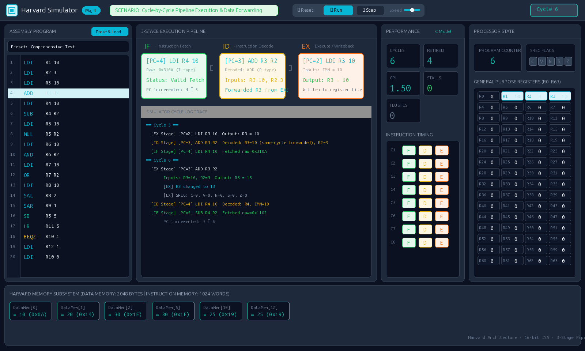
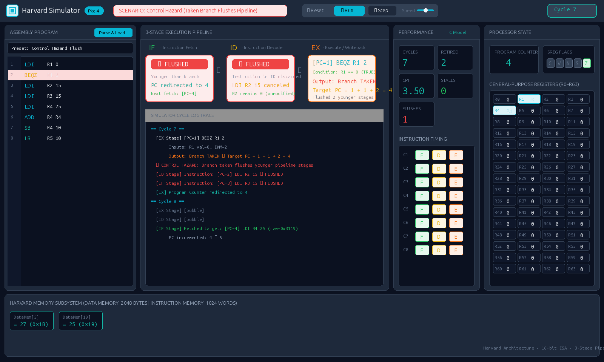

# Harvard Processor Simulator

A cycle-accurate **16-bit Harvard-architecture processor simulator** written in C11, featuring a 3-stage execution pipeline (Fetch, Decode, Execute), full hazard resolution, an interactive real-time web visualization GUI, and an automated test suite of **165 verified tests (100% pass rate)**.


-orange)


---

## Visual Showcase (Web GUI)

The simulator includes a modern, dark-mode web visualization interface built with Vite that illustrates cycle-by-cycle microarchitectural behavior.

### 1. Normal Pipelined Execution & Same-Cycle Data Forwarding
Demonstrates instructions moving through the 3 pipeline stages (`IF → ID → EX`). Reverse-order stage execution (`EX → ID → IF`) enables same-cycle EX-to-ID forwarding, allowing dependent arithmetic instructions to consume results without pipeline stalls:



---

### 2. Control Hazard & Branch Flushing
Demonstrates the resolution of control hazards when a conditional branch (`BEQZ`) or unconditional jump (`JR`) is taken in the Execute stage:




---

## Architecture at a Glance

| Component | Specification |
|---|---|
| **Architecture** | Harvard (separate instruction and data memory buses) |
| **Instruction Memory** | 1024 words × 16 bits (addresses `0` to `1023`) |
| **Data Memory** | 2048 bytes × 8 bits signed `int8_t` (addresses `0` to `2047`) |
| **Registers** | 64 × 8-bit GPRs (`R0`–`R63`), all fully writable |
| **Status Register (SREG)** | 5 condition flags (`C`, `V`, `N`, `S`, `Z`), bits 7:5 always masked to `0` |
| **Program Counter (PC)** | 16-bit unsigned register |
| **Instruction Width** | 16 bits (4-bit opcode, two 6-bit operand fields) |
| **Pipeline Stages** | 3 stages: **IF** (Fetch) → **ID** (Decode) → **EX** (Execute / Writeback) |

### 12-Instruction ISA

- **Arithmetic:** `ADD` (addition + flags `C,V,N,S,Z`), `SUB` (subtraction + flags `V,N,S,Z`), `MUL` (multiplication + flags `N,Z`)
- **Logic:** `AND` (bitwise AND + flags `N,Z`), `OR` (bitwise OR + flags `N,Z`)
- **Shifts:** `SAL` (shift arithmetic left), `SAR` (shift arithmetic right, sign-extended)
- **Data Transfer:** `LDI` (load 6-bit signed immediate `-32`..`+31`), `LB` (load byte from data memory), `SB` (store byte to data memory)
- **Control Flow:** `BEQZ` (branch if `R1 == 0` to `PC + 1 + IMM`), `JR` (jump register to `PC = R1 || R2`)

---

## Quickstart

### 1. Build and Run Simulator

```bash
# Build the C executable
make

# Run sample program
./simulator.exe programs/test_comprehensive.txt

# Run with machine-readable JSON metrics export
./simulator.exe programs/test_comprehensive.txt --json /tmp/run.json
```

### 2. Run Automated Test Suite

```bash
make test
```

### 3. Launch Web Visualization GUI

```bash
cd gui
npm install
npm run dev
```

Open the local URL in your browser (e.g. `http://localhost:5173/`). Select any preset program from the dropdown, click **Parse & Load**, and step through cycles.

---

## Automated Test Suite

A modular test runner in [tests/test_runner.c](tests/test_runner.c) thoroughly verifies the simulator against expected register, memory, and pipeline states:

```text
======================================================================
Test Summary: 165 passed, 0 failed (Total: 165)
Status: ALL TESTS PASSED
======================================================================
```

---


## Collaborators

| Name | GitHub |
|---|---|
| Mohamed Enan | [@Mo7amed3nan](https://github.com/Mo7amed3nan) |
| Ziad Abdou | [@Ziad-Abdou1](https://github.com/Ziad-Abdou1) |
| Mohamed Shams | [@Mo-Shams](https://github.com/Mo-Shams) |
| Adham Jalaal | [@profadham](https://github.com/profadham) |